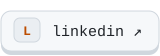
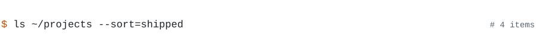
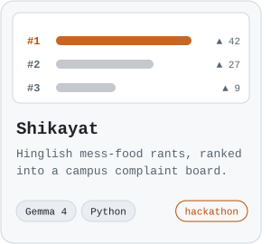
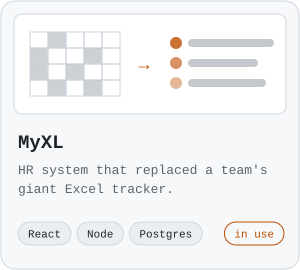
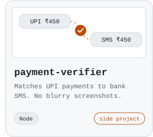
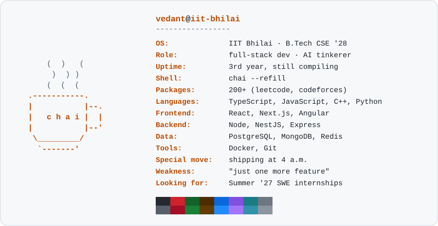
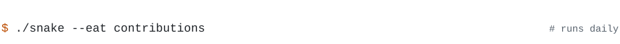

<picture><source media="(prefers-color-scheme: dark)" srcset="assets/header-dark.svg"></picture>

<a href="https://linkedin.com/in/vedantzala"><picture><source media="(prefers-color-scheme: dark)" srcset="assets/key-linkedin-dark.svg"></picture></a>
<a href="https://aure-line.vercel.app"><picture><source media="(prefers-color-scheme: dark)" srcset="assets/key-demo-dark.svg"></picture></a>
<picture><source media="(prefers-color-scheme: dark)" srcset="assets/status-dark.svg"></picture>

<picture><source media="(prefers-color-scheme: dark)" srcset="assets/sh-projects-dark.svg"></picture>

<a href="https://github.com/xtacy-on-code/AureLine"><picture><source media="(prefers-color-scheme: dark)" srcset="assets/hero-aureline-dark.svg"></picture></a>

<a href="https://github.com/sarthak0707git/shikayat"><picture><source media="(prefers-color-scheme: dark)" srcset="assets/shikayat-dark.svg"></picture></a><a href="https://github.com/xtacy-on-code/MyXL"><picture><source media="(prefers-color-scheme: dark)" srcset="assets/myxl-dark.svg"></picture></a><a href="https://github.com/xtacy-on-code/payment-verifier"><picture><source media="(prefers-color-scheme: dark)" srcset="assets/payment-verifier-dark.svg"></picture></a>

<picture><source media="(prefers-color-scheme: dark)" srcset="assets/sh-neofetch-dark.svg"></picture>

<picture><source media="(prefers-color-scheme: dark)" srcset="assets/neofetch-dark.svg"></picture>

<picture><source media="(prefers-color-scheme: dark)" srcset="assets/sh-snake-dark.svg"></picture>

<picture><source media="(prefers-color-scheme: dark)" srcset="https://raw.githubusercontent.com/xtacy-on-code/xtacy-on-code/output/snake-dark.svg"></picture>

<picture><source media="(prefers-color-scheme: dark)" srcset="assets/footer-dark.svg"></picture>
