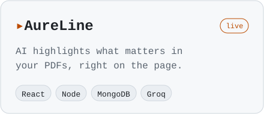
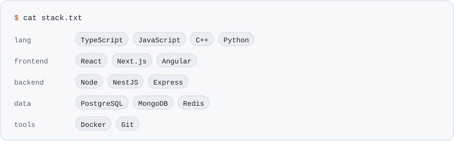

<picture><source media="(prefers-color-scheme: dark)" srcset="assets/header-dark.svg"></picture>

**class:** full-stack dev &nbsp;·&nbsp; **subclass:** AI tinkerer &nbsp;·&nbsp; **special move:** shipping at 4 a.m. &nbsp;·&nbsp; **weakness:** "just one more feature"

[LinkedIn](https://linkedin.com/in/vedantzala) &nbsp;·&nbsp; [AureLine demo](https://aure-line.vercel.app) &nbsp;·&nbsp; open to Summer 2027 SWE internships

### ▸ things i shipped

<a href="https://github.com/xtacy-on-code/AureLine"><picture><source media="(prefers-color-scheme: dark)" srcset="assets/aureline-dark.svg"></picture></a>
<a href="https://github.com/sarthak0707git/shikayat"><picture><source media="(prefers-color-scheme: dark)" srcset="assets/shikayat-dark.svg"></picture></a>
<a href="https://github.com/xtacy-on-code/MyXL"><picture><source media="(prefers-color-scheme: dark)" srcset="assets/myxl-dark.svg"></picture></a>
<a href="https://github.com/xtacy-on-code/payment-verifier"><picture><source media="(prefers-color-scheme: dark)" srcset="assets/payment-verifier-dark.svg"></picture></a>

### ▸ equipped

<picture><source media="(prefers-color-scheme: dark)" srcset="assets/stack-dark.svg"></picture>

### ▸ contributions, eaten daily

<picture><source media="(prefers-color-scheme: dark)" srcset="https://raw.githubusercontent.com/xtacy-on-code/xtacy-on-code/output/snake-dark.svg"></picture>

powered by chai ☕ · no tamagotchis were harmed in the making of this profile

